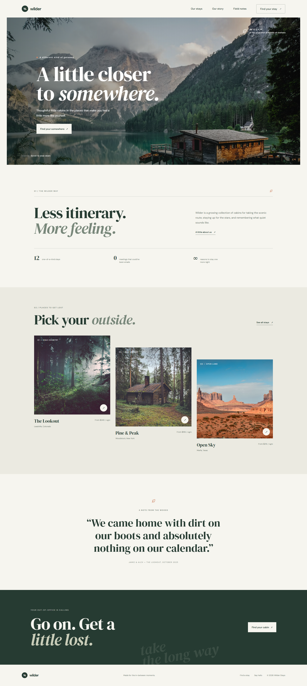

# Wilder

Wilder is a responsive landing page for a fictional collection of thoughtfully designed cabin stays. It introduces the brand, shares the story behind the stays, highlights three destinations, and invites visitors to plan a getaway.

The project is built with plain HTML, CSS, and JavaScript. There is no build step, framework, or package installation required.

## Preview

The screenshot below shows the complete desktop page, from the navigation and scenic hero through the cabin listings and footer.



The screenshot is 1440 pixels wide and includes the full page.

## Page sections

- **Navigation:** Brand mark, links to the main sections, and a prominent stay-finder link. On smaller screens, the links are available from an accessible toggle menu.
- **Hero:** Full-width landscape photography, introductory copy, and a link to browse the stays.
- **The Wilder way:** A short brand introduction with a few editorial-style details.
- **Featured cabins:** Three destinations, each with a photograph, location, and nightly starting price.
- **Guest note:** A centered testimonial to add a personal touch.
- **Booking invitation:** A final call to action, followed by contact and navigation links in the footer.

## Features

- Responsive layouts for desktop, tablet, and mobile screens.
- Small entrance and scroll-reveal animations.
- A mobile navigation menu with an updated expanded state for assistive technologies.
- Reduced-motion support for visitors who prefer fewer animations.
- Semantic page sections, descriptive image labels, and clear heading structure.
- Automatic current year in the footer.

## Run locally

No dependencies need to be installed. Either open `index.html` directly in a browser, or start a local server from the project directory:

```bash
python -m http.server 8000
```

Open [http://localhost:8000](http://localhost:8000) to view the page. Stop the local server with **Ctrl+C** when you are finished.

## Project files

| File | Description |
| --- | --- |
| `index.html` | Page content, navigation, metadata, and links to the styles and script. |
| `styles.css` | Colors, typography, layouts, responsive breakpoints, animations, and reduced-motion styles. |
| `script.js` | Mobile menu interactions, scroll reveals, and the footer year. |
| `screenshot.png` | Full-page desktop screenshot used in this README. |

## Customization

- Edit the page content, navigation labels, destinations, and calls to action in `index.html`.
- Adjust the color palette, typography, spacing, imagery, or responsive rules in `styles.css`.
- Update the menu and reveal behavior in `script.js`.
- The contact links currently use the example address `hello@staywilder.example`; change this to the intended contact address before publishing.

## External assets

The page loads DM Sans and DM Serif Display from Google Fonts and photographs from Unsplash. An internet connection is needed to load these remote assets. Replace the image URLs in `styles.css` if you want to use locally hosted photography.
